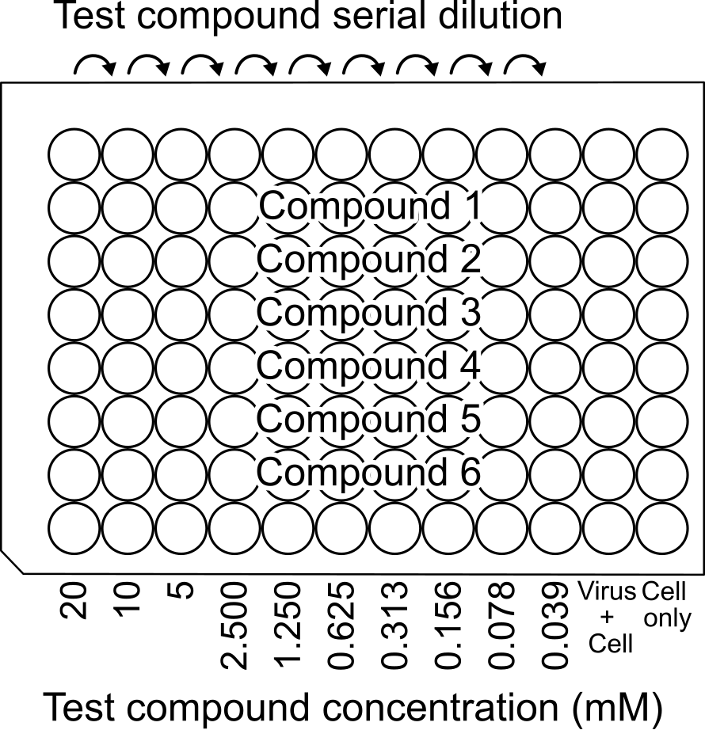

IFA
====

Seeding
----

**Materials** 

* 2% DMEM + HEPES
* Cell counting slide 
* Trypan blue
* Black 96 wp, clear, flat bottom
* Multichannel pipette
* Cell reservoir
* :ref:`1x PBS <pbs1x>`

**Proceudre - Trypsinise**

#. Culture Vero cells in T75 until ~80% confluency.
#. Wash cells with ~3 mL PBS.
#. Trypsinise with 2 mL TrypLE.
#. Dilute TrypLE with 3 mL 2% DMEM.
#. Transfer suspension into 15 mL tube.
#. Centrifuge, 200x g, 5 min.
#. Remove media.
#. Resuspend cell pellet in 1 mL of media. 

**Procedure - Cell count**

#. Add 10 uL of cell suspension into 10 uL of Trypan blue. 
#. Add 10 uL into each side of cell counting slide.
#. Read cell counting slide. 
#. Prepare cells enough for seeding. Mix X uL of 2% DMEM with HEPES added + Y uL cell suspension in a reservoir

    * Final cell density and media vol/well = 10,000 cell in 50 uL media/well 

*Example* 

.. code-block::

    Media for 100 wells = 50 uL * 100 wells = 5,000 uL 
    Cells needed for 100 wells = 10,000 cells/well * 100 wells = 1,000,000 cells/100 wells = 1,000,000 cells/5,000 uL =  200,000 cells/mL 
    Cell suspension concentration = 7.12*10^6 cells/mL
    7.12*10^6 cells/mL * V1 = 0.2*10^6 cells/mL * 10 mL 
    V1 = Vol of cell suspension needed 

**Procedure - Seeding** 

#. Seed cells in 96 well black, flat, clear bottom plate at density of 10,000 cells/well, 50 uL 2% DMEM/well. 
#. Left seeded plate at bench ~10 mins for cells to settle. 
#. Incubate, 37 C, 5% CO2, overnight. 

Infection + treatment
----

* post-infection teatment  
* Treatment dilution: Compound stock -> serial dilution in DMSO plate -> media plate -> test plate

**Materials**

* DMEM with 2% FBS + HEPES
* DMSO plate of diluted compound 
* Cell reservoir
* Multichannel pipette 
* Virus stock 
* 96 well plate, clear, flat bottom

**Procedure - Infection + treatment** 

*Calculate virus MOI*

:math:`\text{Virus stock volume (mL)} = \frac{\text{MOI} \times \text{No. of cells}}{\text{Virus titer (pfu/mL)}}`

* MOI = 1, vol of media does not matter as much, but keep low vol 

#. Add calculated vol of virus stock to appropriate volume of 2% DMEM. Mix well. 
#. Add 25 uL of virus + media mixture into each well in the test plate. Reserve one column for cell only and one column for cell + virus only (Non-treated control).
#. Incubate, 1 hr, 37 C, 5% CO2.
#. Thaw compound DMSO plate.
#. Prepare media plate.

    #. Add 196 uL of 2% media into a clear 96 wp. This is the media plate.  
    #. Transfer 4 uL of diluted compound from DMSO plate to media plate. Mix well.

#. Add 25 uL of compound from media plate according to designated layout in test plate. 
#. Incubate, 48 hrs, 37 C, 5% CO2.

Fixing + blocking + primary Ab
----

**Materials**

* 1x PBS 
* :ref:`PBS-T (Washing buffer) <pbs-t>`
* :ref:`PBS-FT (Blocking buffer) <pbs-ft>`
* 4G2 (Primary antibody, anti-dengue E-protein)

**Procedure - Fixing + blocking + primary Ab** 

#. Remove existing media from wells. 
#. Add 100 uL of PBS into each well. Swirl plate gently and remove PBS. 
#. Add 100 uL of ice-cold methanol into each well and keep plate in -20 C for around 15-20 mins. 
#. Remove methanol and wash cells with 300 uL PBS-T 3 times. 
#. Remove PBS-T and add PBS-FT, 100 uL/well.
#. Swirl plate and incubate at room temperature for 1 hr.
#. Prepare primary Ab. 

    * 1 mg/mL stock, 1:100 dilution with PBS-FT

#. Remove PBS-FT. Add primary Ab, 50 uL/well. 
#. Keep plate in 4 C, overnight. 

Secondary Ab
----

**Materials** 

* :ref:`PBS-FT <pbs-ft>`
* :ref:`PBS-T <pbs-t>`
* Alexa Fluor 488 anti-mouse Ab
* Hoechst
* :ref:`1x PBS <pbs1x>`

**Procedure - Secondary Ab + nucleic acid stain**

#. Prepare secondary Ab and nucleus stain mixture.

    * Alexa Fluor 488 = 1:1000 dilution 
    * Hoechst = 1:2500 dilution 
    * Add both into same PBS-FT, no need to separate

#. Remove primary Ab. 
#. Wash cells with 300 uL PBS-T 3 times.
#. Remove PBS-T. Add secondary Ab, 50 uL/well. Incubate 1 hr, r.t.
#. Remove secondary Ab. 
#. Wash plate 300 uL PBS-T 3 times. 
#. Add 100 uL of PBS into each well.
#. Read plate.

**References** 

:cite:`tanCellBasedFlavivirusInfection2014`
