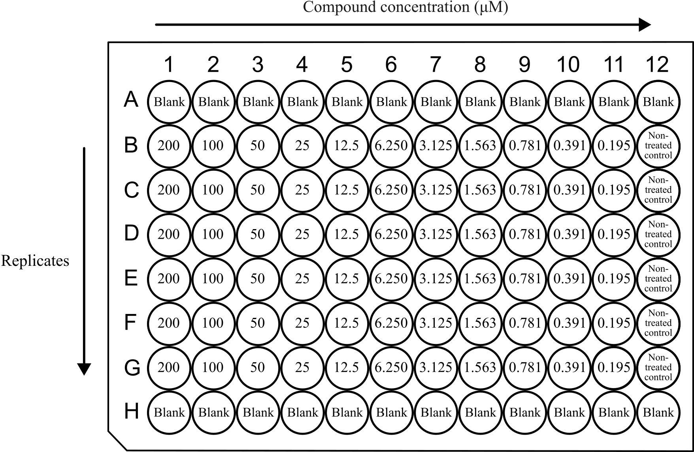

MTT assay
====

* Some important parameters to find out before MTT: 

    * Number of cells to seed in each well 
    * the amount/concentration of reagent to use (PBS, trypsin, DMEM, DMSO, MTT, etc.)
    * time of incubation (12, 24, 36, 48 hrs, etc.) 

* See visual guide `here <https://docs.google.com/presentation/d/1bVLtRDbeNUYgCIJIff3_kx7cVitiwAFbNoAo2k-QTZA/edit?usp=sharing>`_

Planning
----

Before starting, need to calculate 

    * number of cells needed and amount of media needed for one 96 well plate
    * Each well contains 100 uL of mixture of complete DMEM + number of cells required for each well

**Number of cells needed**

Assume for 1 compound, we are testing 

    * 8 different concentrations (including negative control) on the cells 
    * 5 wells for each concentration (supposedly only needed 3 wells for technical replicates, but extra wells were included to compensate for possibly outliers or errors)
    * 5,000 cells in each well
    
then:

    .. code-block::

        Total cells needed = 10 concentrations * 5 wells/concentration * 5,000 cells/well = 250,000 cells (25*10^4 cells)

Take note that even we wanted to test 8 different concentration, but the formula above state :code:`10 concentrations`. This is due to the inevitable deviations or minute errors during pipetting and handling of liquids. If the exact number of concentrations was prepared, there might not be enough cells for the last few wells, so extra amount was prepared for some headroom. Usually adding 2 to 3 concentrations extra into the calculation is sufficient.

**Amount of media needed**

100 μL of media is needed in each well. The concept is similar to above section

    .. code-block:: 
    
        Total media needed = 10 concentrations * 5 wells/concentration * 100 μL/well = 5,000 μL 

Similar to above, :code:`10 concentrations` were used in calculation instead of 8 for some extra headroom

In total, 250,000 cells in 5 mL of media was needed, which makes the concentration :code:`50,000 cells/mL`, or equivalent to :code:`(5*10^4 cells/mL)`

Trypsinise, count, seed
----

* Estimated time required: 1 hr

**Materials**

* 96 well plate 
* Cell reservoir
* Multichannel micropipette
* Trypan blue 
* Counting chamber 
* Click counter 
* 2% DMEM 
* Centrifuge tube (15 mL)
* :ref:`Phosphate buffer saline PBS <pbs>`
* TrypLE 
* Cells in culturing flask at 70-80% confluency
* Incubator 
* Centrifuge 
* Biosafety cabinet (BSC)

#. Remove existing media in culture flask
#. Wash cells with 1-2 mL of PBS
#. Add 1-2 mL (depending on flask size, T25 = 1mL, T75 = 2 mL) of TrypLE into culture flask
#. Incubate culture flask. 37 °C, 3-5 min, not more than 10 min
#. Tap the flask to mechanically detach the cells from culture flask
#. Add amount of complete DMEM equal to the amount of TrypLE added in previous step into the culture flask
#. Transfer cell suspension into centrifuge tube
#. Centrifuge. 4x100 g (or 1500 rpm), 5 min.
#. Discard supernatant.
#. Resuspend cell pellet in 1 mL of 2% DMEM. Repeat pipette gently to break cell clumps.
#. Add 10 uL of trypan blue into one well of a 96 well plate. Add 10 μL of cell suspension from trypsinisation to the same well that have trypan blue. Mix by repeat pipetting.

    * Can use other alternatives for mixing, like parafilm, eppendorf tubes.
    * This example uses 1:1 ratio of cell suspension (10 μL) and trypan blue (10 μL) for dilution. Other dilution factors like 1:4, 1:9 can also be used, just remember to also change the dilution factor during the calculation.

#. Add 10 μL of trypan blue+cell suspension mixture into the cell counting chamber.

    * A counting chamber set up typically consist of a counting chamber with a glass cover slip on top. Add the trypan blue + cell mixture from the edge of cover slip. Capillary action will spread the mixture evenly across the counting area.

#. Count the cells using microscope

    .. image:: images/Cell\ counting.png
        :width: 600

    * After counting the cells, should get value of :code:`X cells/mL`. Compare the counted cell number to the cell number required calculated before the experiment begin. Should have sufficient cells for seeding
    * If cells is not sufficient, might need to adjust cell to seed in each well or passage the cells and wait for the cells to reach higher confluency before seeding to 96 well plate
    * After knowing how much cells we have (:code:`X cells/mL`), need to know how much cells to take from the cell suspension and dilute in media to make the mixture with the final concentration required
    * Assume after counting the cells, we get :code:`300*10^4 cells/mL`, but we only need :code:`5*10^4 cells/mL` (Remember we calculate this value before we begin the procedure)
    * Using formula

        .. code-block::

            C1V1 = C2V2
            300*10^4 cells/mL * V1 = 5*10^4 cells/mL * 5 mL
            V1 = 0.0833 mL (~83.3 μL) 
    
    * In summary, need to add **83.3 μL cell suspension** into **4916.7 μL media**. But since the volume difference is negligible, just add **83.3 μL** of cell suspension into **5,000 μL** of media

#. Mix the cell suspension with either repeat pipetting or vortex before adding cells to reservoir.

    *  To prevent clumping causing cells seeded in each well varies too much.

#. Add appropriate amount of media into the cell reservoir.

    * In this example, add 5,000 μL (5 mL) of media into the cell resesrvoir.

#. Take required volume of cell suspension and mix with mesdia in the cell reservoir.

    * In this example, add 83.3 μL of cell suspension into the cell reservoir.

#. Mix the cells and media evenly by repeat pipetting using multichannel micropiptte.
#. Add 100 μL of cells and media mixture from the cell reservoir into the 96 well plate with multichannel micropipette. 
#. Incubate the seeded 96 well plate for 24 hrs at 37 °C, 5% CO2.

Treatment
----

* Estimated time required: 1 hr
* Treat the seeded cells with the compounds to be tested.
* Before treatment, calculate the concentration of compound needed. Usually the compound will be serial diluted 2-fold before added to the wells. There are serial dilution calculator online that can help us to calculate the dilution
* Assume the cells are seeded in 6 different wells (as in the example above) for each concentration in the previous step, volume of complete DMEM+compound required will be :code:`100 μL * 5 wells = 500 μL`. Again, to compansate for pipette error, prepare 600 μL, a 100 μL extra 

**Materials**

* 2% DMEM
* Multichannel micropipette
* Microcentrifuge tube

**Procedure**

#. Prepare 9 microcentrifuge tube. 
#. Add appropriate amount of 2% DMEM into the first microcentrifuge tube and 700 μL into the rest of the tube.
#. Add appropriate amount of compound stock into the first microcentrifuge tube. Mix well by repeat pipetting.
#. Transfer 700 μL from 1st microcentrifuge tube into 2nd tube. Mix well by repeat pipetting
#. Transfer 700 μL from 2nd microcentrifuge tube to 3rd tube. Mix well by repeat pipetting. Repeat the steps until last tube
#. Retrieve the 96 well plate with Vero cells seeded from incubator.
#. Assign wells for each compound concentrations and label the concentrations on the lid of the 96 well plate.
#. Remove existing media from 96 well plate with multichannel micropipette. 
#. Add 100 μL of fresh media in non-treated control wells.
#. Add 100 μL of serial diluted compound into corresponding wells.
#. Incubate, 24 hrs, 37 °C, 5% CO2.

    * Adjust desired treatment period: 48, 72 hrs, etc.

MTT
----

* Estimated time required: 4 hrs 
* This procedure can be carried out either in the biosafety cabinet or at bench.
* Reduce as much light source as possible (turn off lights, but not so dark that its difficult to see anything) as MTT is light sensitive.

**Materials**

* :ref:`MTT reagent (5 mg/mL) <mtt stock>`
* DMSO 
* Multichannel micropipette
* Aluminium foil
* Cell reservoir
* Incubator 
* Microplate reader 
* Microplate shaker 

**Procedure**

#. Take MTT reagent from freezer and warm it to room temperature before use.
#. Add 10 μL of MTT reagent into each well.

    * **Do not** need to remove media on this step.
    * Final concentration of MTT reagent in each well should 0.5 mg/mL.
    * Other concentrations of MTT can be used, find out from the literature whichever concentration of MTT that is suitable.

#. Wrap well plates in aluminium foil to keep the MTT reagent from light.
#. Incubate. 37 °C, 5% CO2, 1-4 hrs.

    * Different literature report different incubation time, may try to optimise, but be consistant. If 2 hrs of incubation was decided, then incubate 2 hrs everytime MTT assay was carried out.  

#. After incubation, remove the 96 well plate from incubator.

    * Formazan crystals can be observed in the 96 well plate under microscope with 10x magnification.

#. Remove media along with remaining MTT solution with multichannel micropipette.
#. Add 100 μL of DMSO into each well with a multichannel micropipette.
#. Place 96 well plate on shaker and shake for 10-20 mins.

    * This step is to solubilise the formazan crystal.
    * Shaking time can be reduced as long as the crystals are completely dissolve in DMSO. Can observe the plate under microscope to check if there are undissolved crystals.

#. Read plate at 570 nm.

    * There are different protocols that uses different wavelength, may adjust according to literature.

#. After reading the absorbance, dispose the plate into the yellow bin in the lab.

Results
----

Most microplate reader allows the absorbance readings to be easily export to MS Excel file. If not, have to manually insert the values into an Excel sheet. 

There is two approach, either way is fine.

    * Calculate % of viability in each well, then input all value into Graphpad prism. Graphpad will automatically calculate the mean and sd. 
    * Calculate mean and sd in excel, then only insert values into Graphpad prism. 

**Workflow**

#. Average all the reading from the 3 wells of each concentrations (including blank and negative control wells). 
#. Minus off values from blank wells. This is to remove the background noise generated by DMSO (which we used as a blank). 

    * If microplate reader have function to automatically minus the blank from the sample and non-treated control wells, then can skip this step.

#. Divide absorbance reading of each sample well by the absorbance reading of non-treated control. 
#. Multiply the value by 100 to convert to percentage. 
#. Plot graph in graphpad prism or any other software to calculate IC50.

:math:`\text{Inhibition (%)} = \frac{T}{NTC} \times 100\%` 

T = Treated; NTC = Non-treated control 

FAQ
---

There are some parameters that need to find out before starting MTT assay including:

#. *How many cells to seed in each well?*

    * The common approach is to refer to the published research articles related to the cell lines we are working with to get an idea on how many cells we should seed. 
    * If cannot get the information, some optimisation can be done by trying out any range between 1,000 to 50,000 cells/well. 
    
#. *How many different concentrations of compounds we need to test?*

    * Concentrations of compound to test depending on the solubility of the compound in DMSO or other solvent (like water), different compound has different solubility in DMSO. Even if a compound is completely soluble in DMSO, it may precipiate when attempt to dilute with media during serial dilution. 
    * If have no idea what compound concentrations to use, can try out by using a larger range of concentrations first. Around 200 uM is a good starting point and half it for each dilution step (200, 100, 50...)
    * If the compound was dissolve in DMSO, make sure the final concentration of DMSO in each well is not more than 1%. Calculate with C1V1=C2V2.

#. *Other common questions including 'How long I should incubate? How much MTT reagent I should use?'*

    * The list of questions are non-exhaustive and can be difficult answer as these parameters are related to multiple factors like what cell lines we are dealing with, what is the purpose of the experiments, etc. 
    * Fortunately, there are a lot of resources availabel, always check published articles, or ask around other lab members who had experience with the particular cell lines. 
    * For most part, the parameters should be transferrable from one cell line to another. 

.. image:: images/MTT\ assay.png
    :width: 600

References
----

:cite:`guillen2022effect,marin2021curcumin`