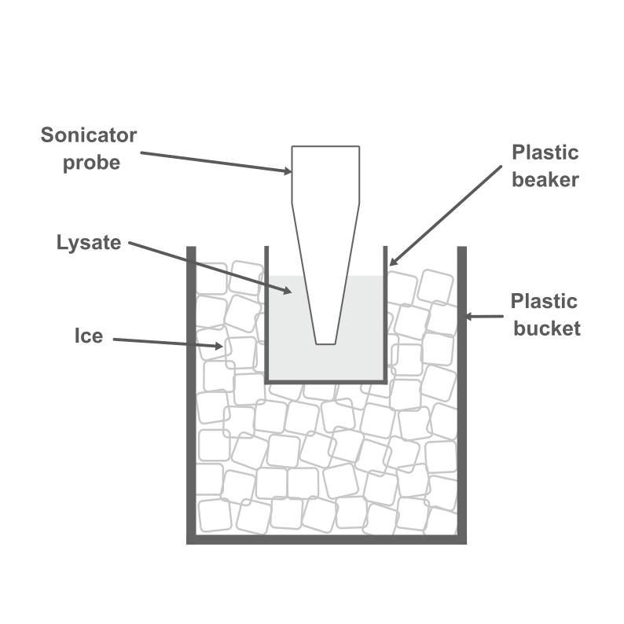

Protein extraction and purification
====

Buffers 
---

* Prepare the buffers preferrably at least one day before use, weighing and stirring can take up significant amount time, some buffers also need to be pre-cooled in the cold room. 
* :ref:`Lysis buffer <lysis>`
* :ref:`Buffer B <buffer_b>`
* :ref:`Buffer C <buffer_c>`
* :ref:`Buffer D <buffer_d>`

Protein extraction
----

* Estimated time required: 3 hrs
* The bacterial pellet from the end of :ref:`expression <protein-expression>` procedure was stored at -80 °C. Extraction and purification would proceed from there.  
* Schematics `here <https://docs.google.com/presentation/d/1BdfENuEXn2LxE8Z-RVcmCcj58yvbUPIr10xUoM2XLIg/edit?usp=sharing>`_.

**Materials**

* Plastic bucket
* Ice 
* Microcentrifuge tube (1.5 mL)
* Centrifuge tube (15 mL and 50 mL)
* Ni-NTA resin 
* :ref:`Lysis buffer <lysis_buffer>`
* :ref:`Buffer B <buffer_b>`
* Rotator
* Plastic beaker (10 mL)
* Refrigerated centrifuge (can fit 50 mL centrifuge tube)
* Refrigerated microcentrifuge (can fit 1.5 mL microcentrifuge tube)

**Procedure**

#. Retrieve the bacteria pellet from -80 °C.
#. Add 25 mL of lysis buffer into the centrifuge tube and resuspend the pellet completely. Mix with a vortex mixer. Use micropipette to break the pellet if necessary.  

    * It is normal for the suspension to become slimy after lysis buffer was added.

#. Leave the centrifuge tube at room temperature for 30 mins.

    * Optional: Rotate the centrifuge tube at 60 rpm with a rotator. 
    * Can :ref:`prepare Ni-NTA resin <resin_prep>` while waiting for the incubation. 

#. Pour suspension into small plastic beaker. Surround the plastic beaker with ice so the sample do not denature due to heat generated during sonication process. 
#. Homogenise the suspension using sonicator. 

    * Sonicator settings in Mol Med: output 10-20, duty cycle 70%, 2 sec on, 0.5 sec off, for 1-2 mins, on ice.   
    * Sonicator settings in FOP: Amp 35% (Max amp for probe is 40%, over 40% can risk breaking the probe), 2 sec on, 0.5 sec off, for 1-2 mins, on ice. 
    * Sonicate until the suspension form a layer of froth. If froth does not form, repeat the sets until the suspension froth. Wait 2-5 mins between sets to cool the suspension down, as high heat output from sonication may denature the proteins.
    * Split the bacteria cell lysate to smaller volume or multiple portions and sonicate them seperately. It is more efficient this way instead of trying to sonicate the cell lysate all at once. 

#. Transfer the homogenised suspension into a new 50 mL centrifuge tube. 
#. Centrifuge. 8000 rpm, 4 °C, 15 mins.  

*Sonication setup*

.. _resin_prep:

*Preparation of Ni-NTA resin*

#. Mix the Ni-NTA solution well before use. 

    * Ni-NTA would form a thick gel-like layer at the bottom of the container if left standing for some time.
    * Invert the container multiple times to resuspend the gel-like substance completely into the solution. Make sure no blue coloured gel like substance at the bottom of the bottle. 

#. Add 2.5 mL of Ni-NTA resin into 50 mL centrifuge tube. 
#. Centrifuge. 500 x g (or 3,000 rpm), 5 mins.
#. Remove supernatant.

    * The precipitate can easily resuspend into the solution with the slightest movement, remove supernatant slowly and with care. 

#. Resuspend pellet with 5 mL of Buffer B. 
#. Centrifuge. 500 x g (or 3,000 rpm), 5 min.
#. Remove supernatant. 
#. Keep the 50 mL centrifuge with Ni-NTA in ice until later use. 

Protein purification (after lysis)
----

* Estimated time required: 4 hrs

#. Remove supernatant from the centrifuged tube.

    * Collect 100 μL of supernatant for SDS-PAGE later (**sample #0**)

#. Add 2 to 5 mL of Buffer B to the pellet and vortex to completely dissolve the pellet. 
#. Add Buffer B into the tube up to 24 mL of volume. 

    * Collect 100 μL for SDS-PAGE later (**sample #1**)

#. Cool the sample on ice for 30 mins to 1 hr. 
#. Devide the suspensions into 24 microcentrifuge tubes (1 mL per microcentrifuge tube).
#. Centrifuge. 20,000 to 27,000 x g (or 15,000 rpm), 4 °C, 10 mins. 
#. Collect supernatant.

    * Collect 100 μL of the collected supernatant for SDS-PAGE (**sample #2**)

#. Collect pellet. 

    * To make SDS-PAGE sample of pellet, add 1 mL of lysis buffer or Buffer B to pellet and mix using vortex. 
    * Leave the pellet on ice for 1 hr, then collect 100 μL of suspended pellet for SDS-PAGE (**sample #3**)

#. Add the collected supernatant to Ni-NTA resin

    * Store all pellet in their respective tube at 4 °C

#. Bring rotator into cold room. Rotate the Ni-NTA. 4 C, 30 mins to 1 hr.
#. Centrifuge. 500 x g (or 3000 rpm), 4 C, 5 mins. 
#. Remove supernatant.
    
    * Collect 100 μL of supernatant for SDS-PAGE (**sample #4**)

#. Add 10 mL Buffer B into the Ni-NTA resin and mix well. 
#. Centrifuge. 500 x g (or 3,000 rpm), 4 °C, 5 mins.
#. Remove supernatant. 

    * Collect 100 μL of supernatant for SDS-PAGE (**sample #5**)

#. Transfer Ni-NTA resin to column using 10 mL of Buffer B and collect the elution. 

    * Collect 100 μL for SDS-PAGE (**sample #6**) 

#. Add 10 mL of Buffer B and collect the elution. 

    * Collect 100 μL for SDS-PAGE (**sample #7**)

#. Add 2 mL of Buffer C and collect the elution. 

    * Collect 100 μL for SDS-PAGE (**sample #8**)

#. Repeat the previous steps for 4 more times. A total of 4 fractions will be collected. 

    * Collect 100 μL for SDS-PAGE (**sample #9-#12**)

#. Run SDS-PAGE for all 12 samples. 

SDS-PAGE for protein purification
----

* Refer to :ref:`SDS-PAGE <sds-page>` 

Dialysis
----

* Estimated time required: 6.5 hrs 
* This procedure needs to be carried out in cold room.
* Select 2 to 3 fractions containing the target protein based on the result from SDS-PAGE.  

**Materials**

* Thermo Fisher Scientific Slide-A-lyzer Dialysis Cassette, 3,500 MWCO
* Beaker (1 L)
* Magnetic stirrer
* Retort stand
* Syringe
* Needle 
* Microcentrifuge tube (1.5 mL)
* :ref:`Buffer D <buffer_d>`

**Procedure** 

#. Pre-cool Buffer D to 4 °C at least 30 mins before starting dialysis. 
#. Add 1 L of Buffer D into a beaker. 
#. Pre-wet the dialysis membrane by submerging the dialysis cassette in to Buffer D for 5 to 10 mins. 
#. Remove the cassette from the buffer. 
#. Transfer the selected fractions from centrifuge tube into the cassette by using a needle and syringe. 
#. Submerge the cassette into Buffer D. 
#. Leave the set up in the cold room for 2 hrs. 
#. After 2 hrs, remove existing buffer and add fresh buffer D. Leave the set up for another 2 hrs. 
#. After 2 hrs, remove existing buffer and add fresh buffer D. Leave the set up overnight. 
#. Collect the dialysised solution from cassette into multiple microcentrifuge tube (500 μL - 1 mL/tube). 
#. Store the purified protein at -80 °C. 
#. Perform Bradford assay to estimate concentration of the purified protein. 